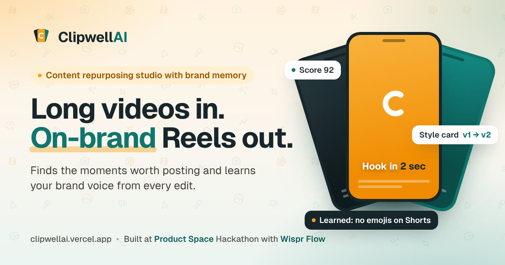
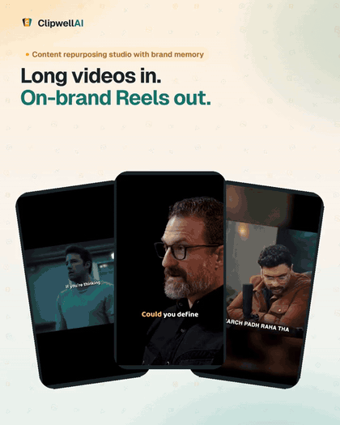
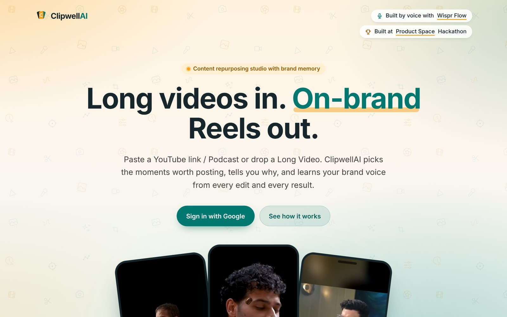
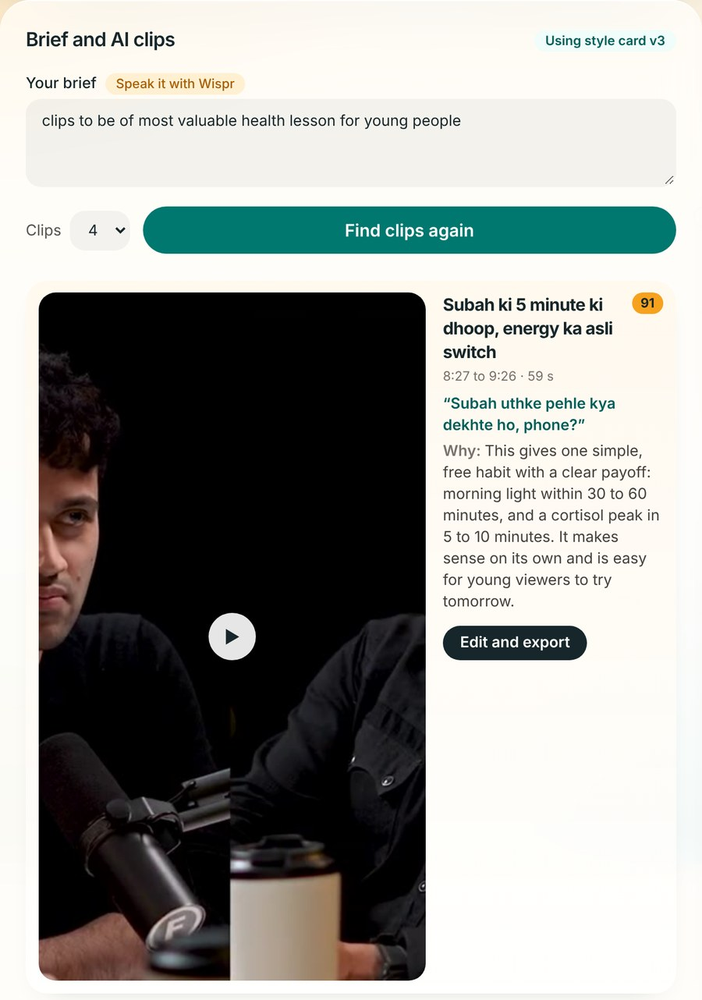
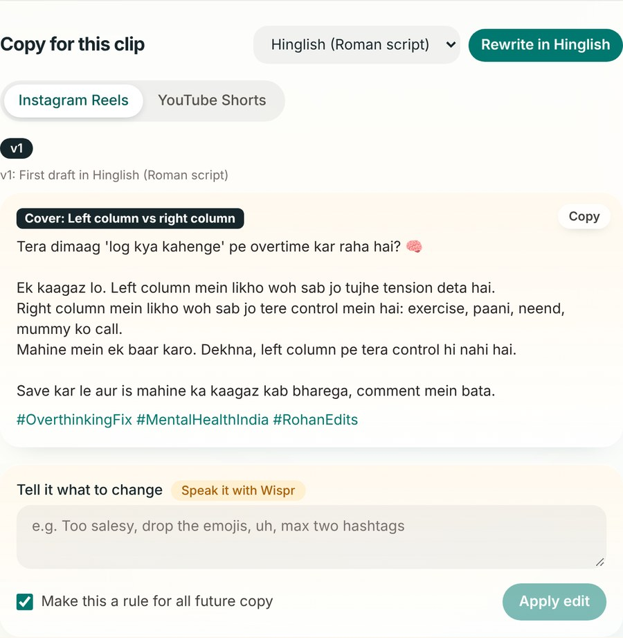
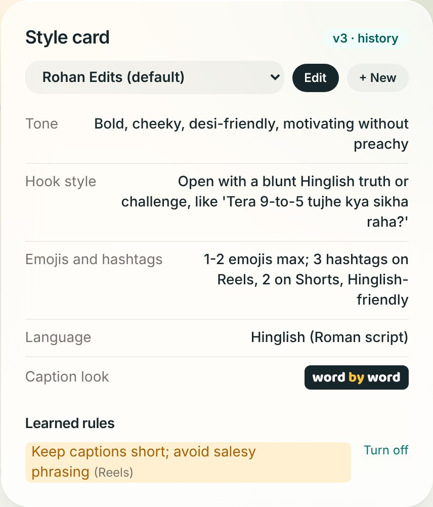
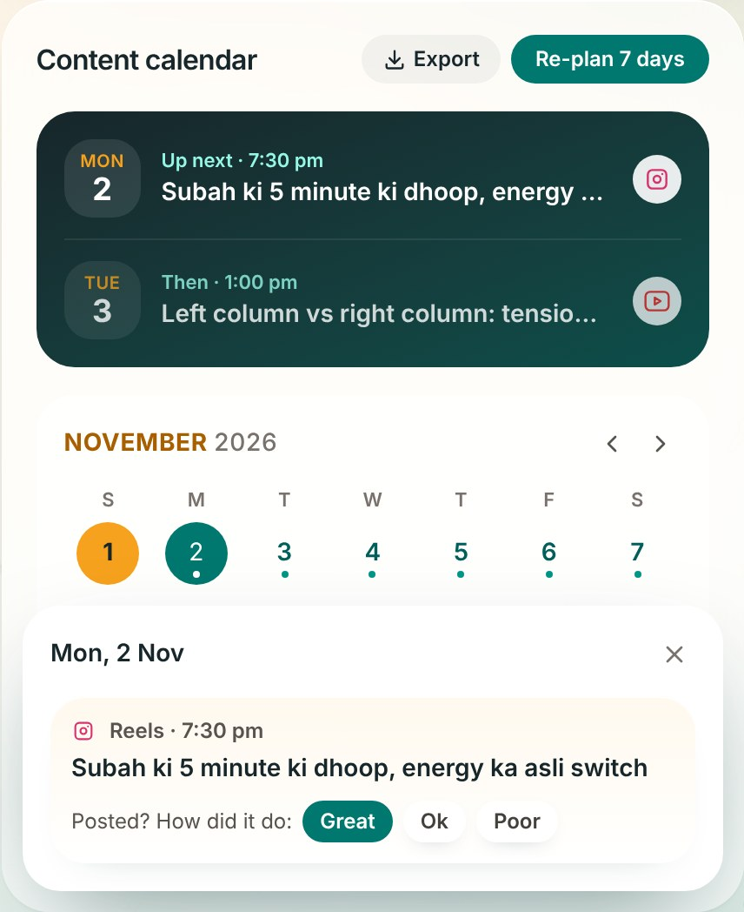

<p align="center">
  <a href="https://clipwellai.vercel.app"></a>
</p>

<h1 align="center">ClipwellAI</h1>

<p align="center">
  <b>Long videos in. On-brand Shorts and Reels out.</b><br>
  A content repurposing studio with brand memory. It finds the moments worth posting, writes the copy,<br>
  and learns your brand's voice from every edit and every result.
</p>

<p align="center">
  <a href="https://clipwellai.vercel.app"><b>Live app</b></a> &nbsp;·&nbsp;
  <a href="https://clipwellai.vercel.app/#how">Demo on the site</a> &nbsp;·&nbsp;
  <a href="docs/SETUP.md">Run it yourself</a>
</p>

<p align="center">
  
  
  
  
  
  
</p>

---

## The problem

Brands and creators sit on hours of podcasts, workshops and founder talks. Turning them into Shorts and Reels is slow, and generic AI clippers forget your voice, so every caption needs the same fixes again: too salesy, too many emojis, wrong language.

ClipwellAI keeps a **style card** for each brand that learns from your edits and from how your posts actually performed. The tenth clip needs fewer fixes than the first.

Built on 31 October 2026 for Problem Statement 01, *Content Repurposing Studio with Brand Memory*, at the **Product Space × Wispr Flow AI Hackathon**, by voice with Wispr Flow.

## Demo

<p align="center">
  
</p>

## How it works

| Step | What happens |
| --- | --- |
| **1. Long video in** | Upload a video (up to 4 hours) or paste a YouTube link. The audio is pulled out in the browser and transcribed with word-level timings. English, Hindi, Hinglish or auto-detect. |
| **2. Brief → clip picks** | Say what you want, typed or spoken with Wispr Flow. The AI returns 3 to 5 clips, each with a hook, a score out of 100 and a plain-language reason for the pick. |
| **3. Edit and export** | Trim each clip, choose framing (centre, left, right, or split for two speakers) and export a 9:16 MP4 with word-by-word captions burned in. Rendering happens in the browser. |
| **4. Copy per platform** | An Instagram Reels caption and a YouTube Shorts title and description, with hashtags, in the brand's tone and language. |
| **5. Brand memory** | Change the copy in plain words: *"too salesy, drop the emojis, max two hashtags"*. Tick *Make this a rule* and the style card learns it, so every future clip follows it. |
| **6. Content calendar** | Plan the next 7 days of posts from your clips and export the plan as a CSV for Google Sheets. |
| **7. Learns from results** | After posting, mark each clip Great, OK or Poor. What worked and what flopped goes back into the style card and shapes the next picks. |

## Screenshots

<p align="center"></p>

<table>
  <tr>
    <td width="50%" valign="top"><b>Clip picks, each with a reason</b><br><br></td>
    <td width="50%" valign="top"><b>Copy in the brand's voice, edited in plain words</b><br><br></td>
  </tr>
  <tr>
    <td width="50%" valign="top"><b>A style card that learns</b><br><br></td>
    <td width="50%" valign="top"><b>A week of posts, planned</b><br><br></td>
  </tr>
</table>

## What makes it different

- **Brand memory that compounds.** Tone, hook style, emoji and hashtag rules, language and caption look live on a versioned style card (v1, v2, v3…). Rules can apply to every platform or only to Shorts or Reels, and can be switched off at any time.
- **Reasons, not just picks.** Every clip says why it was chosen, so you can judge it in seconds.
- **Feedback from real results.** Posting outcomes feed back into the next round of picks.
- **Several brands, one studio.** Keep a style card per brand, set a default and choose one per project.
- **Private by design.** The video file never leaves your computer. Only the audio is sent for transcription, and each user can only see their own projects (row-level security).

## Tech

| Layer | Choice |
| --- | --- |
| App | Next.js 15 (App Router, TypeScript, Tailwind CSS v4) on Vercel |
| Auth and data | Supabase: Google sign-in, Postgres with row-level security |
| Clip picks, copy, style-card learning | Anthropic Claude, with structured (tool-use) output |
| Transcription | Groq Whisper large-v3-turbo, audio sent in 5-minute parts |
| Video | ffmpeg.wasm in the browser: audio extraction, 9:16 framing, burned-in captions |

```
app/            pages and API routes (clips, copy, edit, style card, transcribe, youtube)
components/     studio UI: upload, clip picks, editor, copy panel, style cards, calendar
lib/            Claude client, prompts, storage, media (ffmpeg) helpers
supabase/       database schema and row-level security policies
```

## Run it yourself

```bash
git clone https://github.com/RounakBisht/ClipwellAI.git
cd ClipwellAI
npm install
cp .env.example .env.local   # fill in your own keys
npm run dev
```

You need a Supabase project (run `supabase/schema.sql`, turn on Google sign-in), a Groq API key and an Anthropic API key. The full checklist, including deploying to Vercel, is in [docs/SETUP.md](docs/SETUP.md). To try it without Supabase, set `NEXT_PUBLIC_DEMO_MODE=true` and your data stays in the browser.

## Team

- **Rounak Bisht**: product and build · [GitHub](https://github.com/RounakBisht) · [LinkedIn](https://www.linkedin.com/in/rounak-bisht-/)
- **Kartik Manral**: co-builder, set up Supabase and Google sign-in · [GitHub](https://github.com/KartikManral) · [LinkedIn](https://www.linkedin.com/in/kartik-manral-b08383249/)
### Who built what

**Rounak Bisht**
- **Problem and scope:** picked problem statement 01, made brand memory the differentiator and wrote the product brief.
- **Brand memory (style cards):** fields, rules and versions, and how the card learns from edits and results.
- **AI clip picks and copy:** Claude prompts for clips with a reason and score, and Reels and Shorts copy in the brand's voice and language.
- **Media pipeline:** in-browser audio extraction, Hinglish transcription with Groq Whisper, and 9:16 export with burned-in captions.
- **Studio UX:** the upload flow, clip editor (trim, framing, caption preview) and copy panel.
- **Feedback loop:** Great / OK / Poor results feeding the style card, and the Suggestions panel.

**Kartik Manral**
- **Auth and database:** Supabase setup, Google sign-in, database schema and row-level security.
- **Content calendar:** the 7-day posting plan and CSV export for Google Sheets.
- **Visual identity and homepage:** logo, palette, hero and the mobile layout.
- **Launch:** GitHub and Vercel setup, deployment and going live.

Built with [Claude Code](https://claude.com/claude-code) as our coding partner; it is credited as co-author on the commits.

## License

[MIT](LICENSE): free to use, change and share.
